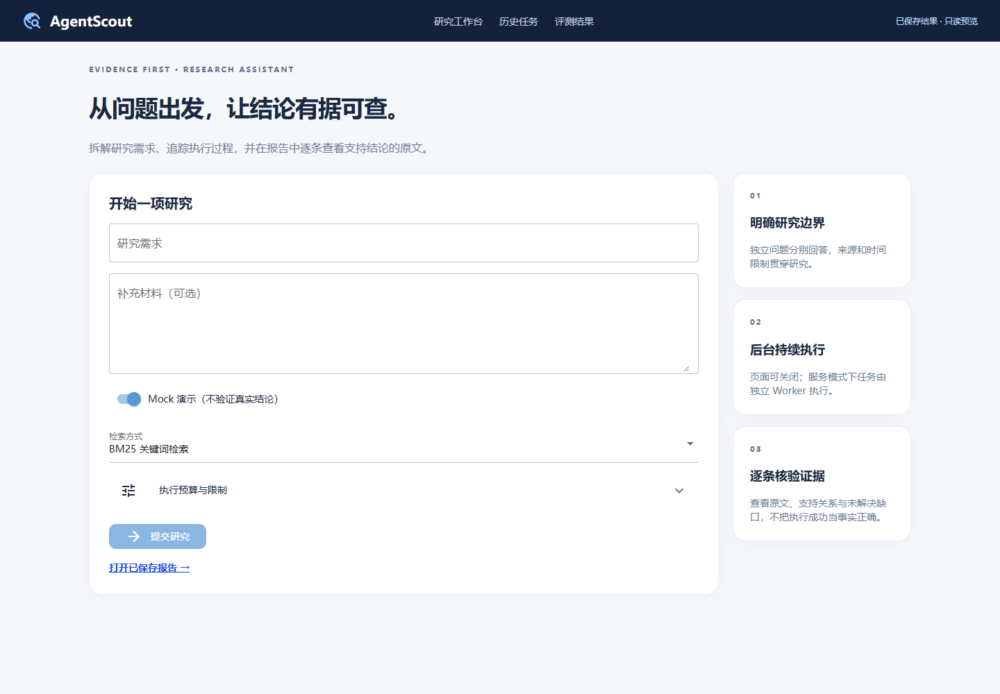
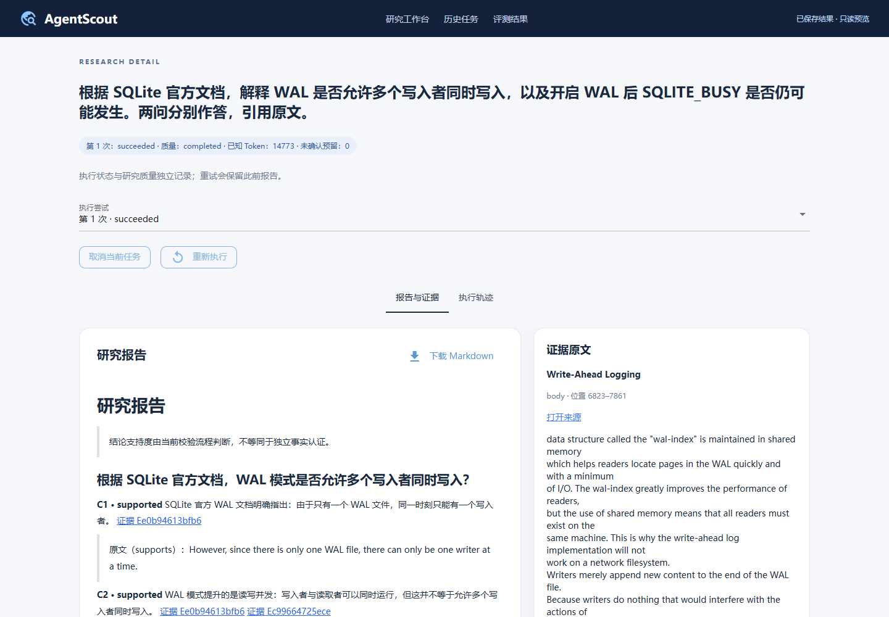
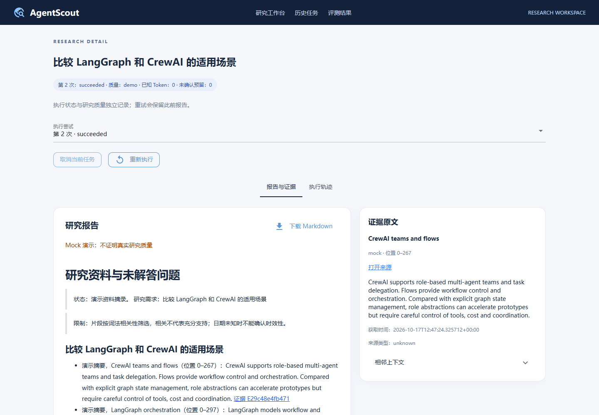
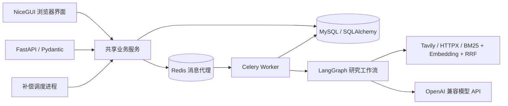

# AgentScout · 有证据的异步研究助手

AgentScout 将研究需求拆成独立问题，检索并抓取资料，再把报告中的结论与精确引文对应起来。Web 页面负责提交与阅读，Celery Worker 负责研究，MySQL 保存任务事实。执行成功和研究质量分别记录。

> 当前为 0.3 改造工作版本（2026-10-17）。WSL / Docker 已安装并运行，Linux 全量回归 123 项通过，真实 MySQL / Redis / Celery 服务的浏览器闭环、故障补偿及容器重启验收通过。远端 CI 尚未运行；受控回答对照实验和独立人工标注仍待补齐。

## 界面





截图来自实际 NiceGUI 页面，报告使用本轮已保存的 SQLite WAL 真实研究结果。右上角标明“只读预览”。后台队列另由真实服务浏览器测试验收，服务使用 Mock 研究且界面明确标识。页面支持结论展开、证据原文/相邻上下文、Markdown 下载、执行轨迹和窄屏阅读。[截图说明](docs/screenshots/README.md)



## 技术架构



| 技术 | 解决的问题 | 实现边界 |
|---|---|---|
| Python / LangGraph | 规划、取证、结构化写作、逐结论核验、有限补查 | 节点快照不是图断点续跑 |
| NiceGUI / FastAPI / Pydantic | 页面、HTTP 契约、参数校验、共享服务层 | 单实例、单操作者，本地访问 |
| MySQL / SQLAlchemy / Alembic | 任务与尝试、事务、唯一约束、结构迁移 | MySQL 是正式业务事实来源 |
| Celery / Redis | 异步排队、独立 Worker、重复投递隔离 | 不承诺外部 API exactly-once |
| Tavily / HTTPX | 搜索、有界并发抓取、超时、下载上限 | 支持 HTML / 文本，不提供浏览器或 PDF 解析 |
| BM25 / FastEmbed / RRF | 有限资料集的词法、语义与融合检索 | 不建设跨任务向量库，默认 BM25 |
| Docker Compose / pytest / GitHub Actions | 环境定义、回归、数据库与进程测试 | 实际通过情况见验证记录 |

## 研究质量闭环

1. 从原始需求保留独立问题、来源和时间限制；来源要求不被拆成独立研究问题。规划失败使用规则降级，超过问题数上限会明确失败。
2. 遍历已下载正文的片段，保留清洗文本偏移、段落条件和例外；不使用“前 8000 字符”替代检索。下载上限和模型上下文预算仍有限。
3. 官方文档要求使用显式 HTTPS 前缀约束；官方域名下的论坛及重定向落到论坛的页面不能自动成为官方文档。搜索摘要和正文分别标记。
4. 生成 `StructuredReport → Question → Claim → Support`，URL 从证据记录渲染。逐字引文存在、所属问题合法、来源类型符合要求之后，再检查语义支持。
5. 每个结论和问题必须有核验项；缺证据、矛盾、未知时效不能直接放行。引用最多修复一次，补查受轮数、时间、调用、Token 和无新证据停止条件限制。

结论核验仍使用模型，不能当独立人工认证。复合结论的原子性主要通过提示和语义检查约束，尚不能确定性保证。材料中的恶意指令不能更改代码层工具权限与预算，但语义提示注入防护不等于绝对免疫。

## 后台执行与一致性

- **任务 / 尝试分离**：重试创建新 Attempt，保留旧报告和记录。Task 累计 Token 与搜索上限跨尝试生效。
- **提交与派发**：事务先写 `pending_dispatch`，然后发消息；发布失败留待补偿，按次数/间隔有限重发。重复幂等键不同请求返回 409。
- **有效执行权**：Worker 原子领取令牌，重复消息不能再领取；心跳失效或取消后，迟到写入不能覆盖新尝试。
- **短事务**：不持有数据库事务等待模型/搜索；报告、质量状态、最终执行状态在一个事务提交。
- **取消**：排队任务立即使后续消息失效；运行任务在控制边界协作停止，不能撤回已经发出的外部调用。
- **未知费用**：模型调用前持久化预留；无 usage 的失败保留占用。Worker 丢失按剩余 Token 上限保守预留，不当作免费。

| 执行状态 | 研究质量 |
|---|---|
| pending_dispatch / queued / running | unassessed |
| succeeded | completed / partial / insufficient_evidence / needs_review / demo |
| failed / cancelled | unassessed |

`succeeded` 代表执行与持久化结束。`completed` 代表通过当前质量门槛。`demo` 只代表 Mock 演示。历史导入使用 `legacy`，不重新认证旧报告。

## 启动

### 完整服务：Docker Compose

需要能运行 Linux 容器的 Docker Engine / Docker Desktop。Windows 首先确认 `wsl --version` 和 `docker info` 成功；仅下载 Ubuntu APPX 不能替代 WSL 运行时。不要把 Windows 原生 Celery 当成部署验收。

在项目根目录准备 `.env`；已有配置不要覆盖：

```powershell
if (-not (Test-Path .env)) { Copy-Item .env.example .env }
docker compose config --quiet
docker compose up -d --build
docker compose ps
```

浏览器打开 `http://127.0.0.1:8080`。API 说明在 `/docs`。初次使用保持 Mock 开关开启，不调用模型或搜索。迁移容器先执行 `alembic upgrade head`，成功后 Web / Worker / Reconciler 才启动。

MySQL、Redis 不映射宿主机端口，Web 仅绑定本地。默认示例密码只用于本地演示；自行设置 `MYSQL_PASSWORD` 和 `MYSQL_ROOT_PASSWORD`，复杂数据库密码需按连接 URL 的规则编码。

```powershell
docker compose logs --tail 100 web worker reconciler
docker compose stop
docker compose start
# 删除容器但保留数据库卷：
docker compose down
```

不要在需要保留数据时使用 `down -v`。迁移是有版本的结构变更；升级真实数据库前备份。已验证全部服务容器重启后报告保留；备份恢复演练尚未执行，不能由重启测试替代。

### 无容器：只读界面演示

此方式用于查看界面，不提供另一套 SQLite 业务后端。Python 3.11+：

```powershell
python -m venv .venv
.\.venv\Scripts\python.exe -m pip install -r requirements.lock
.\.venv\Scripts\python.exe scripts/demo_app.py
```

打开 `http://127.0.0.1:8502`，点击“打开已保存报告”。脚本以空密钥运行 Mock 核心，再加载只读界面；没有后台队列，提交/取消/重试禁用。也可以用 `scripts/preview_saved.py PATH_TO_STATE.json` 查看已有记录，不重新调用模型。

本次本机使用 `.venv-upgrade`，保留原 `.venv`；文档中的 `.venv` 表示新安装时创建的环境。

### 可选混合检索

```powershell
.\.venv\Scripts\python.exe -m pip install -r requirements-embedding.txt
.\.venv\Scripts\python.exe scripts/prepare_embeddings.py
docker compose -f compose.yaml -f compose.embedding.yaml up -d --build
```

实际准备的模型是 `sentence-transformers/paraphrase-multilingual-MiniLM-L12-v2`，384 维、本地 CPU、模型元数据为 Apache-2.0。准备脚本显式下载并记录文件哈希。模型原生窗口有限，因此先按 tokenizer 生成 120 Token 窗口并保留 16 Token 重叠，再聚合向量；不能让模型默认截断吞掉尾部。

研究任务不会自动下载模型。模型不可用会记录 BM25 降级，不能把降级算成混合检索通过。API Embedding 是独立可选配置，不能假设聊天模型供应商同时提供向量能力；本轮实际运行的是本地模型。

## 配置与预算

配置优先级为环境变量 > 开发 `.env` > 默认值；`AGENTSCOUT_NO_DOTENV=1` 禁止加载本地配置。密钥排除在 Settings 序列化之外，模型接口错误脱敏。

| 配置 | 默认值 | 含义 |
|---|---:|---|
| MAX_TOTAL_TOKENS / MAX_TASK_TOKENS | 100000 / 120000 | 尝试 / 跨重试任务预算 |
| MAX_SEARCH_CALLS / MAX_TASK_SEARCH_CALLS | 12 / 24 | 尝试 / 跨重试搜索次数 |
| MAX_TASK_ATTEMPTS | 3 | 最多尝试次数 |
| MAX_ROUNDS / MAX_LLM_CALLS | 2 / 10 | 检索轮数 / 模型调用数（包含重试） |
| RESEARCH_TIMEOUT_SECONDS | 180 | 研究协作式截止时间 |
| MAX_DOWNLOAD_BYTES / FETCH_CONCURRENCY | 2000000 / 3 | 单页下载上限 / 并发度 |
| CONTEXT_TOKEN_BUDGET / EVIDENCE_TOKEN_BUDGET | 16000 / 6500 | 上下文 / 选中证据预算 |
| DISPATCH_MAX_ATTEMPTS / DISPATCH_INTERVAL_SECONDS | 10 / 60 | 补偿派发次数 / 间隔 |
| HEARTBEAT_TIMEOUT_SECONDS | 90 | 失联判定阈值 |

真实研究需 `LLM_BASE_URL`、`LLM_MODEL`、`LLM_API_KEY`；联网还需 `TAVILY_API_KEY`。本项目使用 Tavily REST，不把带密钥的 MCP 链接当模型地址。官方来源任务还需在页面填写前缀，例如 `https://sqlite.org/`。

价格为 0 代表未配置价格，不代表免费。Token 预估不是供应商精确账单，实际 usage 可与估算不同；不宣称绝对账单硬上限。搜索费用另计。“不要联网”仅禁用搜索/抓取，真实模式仍会把相关文本发往配置的模型 API。

## API

| 路由 | 用途 |
|---|---|
| POST /api/v1/tasks | Idempotency-Key 请求头，落库并返回 202 |
| GET /api/v1/tasks | 游标分页，状态及 UTC 日期筛选 |
| GET /api/v1/tasks/{id}、/api/v1/tasks/{id}/attempts | 当前任务与历史尝试 |
| POST /api/v1/tasks/{id}/cancel、/api/v1/tasks/{id}/retry | 取消当前尝试 / 新建尝试 |
| GET /api/v1/attempts/{id}/events | 增量事件游标 |
| GET /api/v1/attempts/{id}/report?download=true | Markdown 导出 |
| GET /api/v1/attempts/{id}/evidence | 分页证据 |
| GET /api/v1/attempts/{id}/sources/{source_id} | 原文与偏移上下文 |
| GET /health/live、/health/ready | 存活 / MySQL 和 Redis 就绪 |

## 测试和真实结果

```powershell
.\.venv\Scripts\python.exe -m pytest -q
.\.venv\Scripts\python.exe -m pip check
.\.venv\Scripts\python.exe -m evals.retrieval_experiment
```

最后一条需要已准备的本地模型，无付费 API。MySQL 测试必须使用独立的 `agentscout_test` 数据库；队列测试需 Linux 和本地专用 Redis DB 15，配置 `TEST_DATABASE_URL`、`TEST_REDIS_URL`。未配置时显示 skipped，不能算通过。CI 会执行 Alembic 迁移和 schema check；配置已编写不代表远端 CI 已通过。

本地 Windows 回归 **109 passed / 14 skipped**；跳过项为真实数据库或 Linux 队列测试。Linux 容器全量回归 **123 passed / 0 skipped**，Alembic 迁移与 schema check、依赖检查均通过。浏览器验收覆盖提交、报告/证据、下载、刷新、双会话及重试历史；故障验收覆盖 Redis 中断补发、取消及服务重启。服务测试使用 Mock 研究，真实数据库与后台进程。

本轮授权的 **5 次真实任务已全部执行**，已知用量 55,897 Token、8 次搜索、22 次模型调用，未确认 Token 预留为 0；账单金额未核对。3 次 completed、2 次 partial，其中首次 WAL 失败记录保留，矛盾材料保持 partial 是预期保守行为。具体代码在迭代中变化，不能用此计算通用准确率或受控提升幅度。

长文真实验证引用位于 **11,201–11,280 字符**，同时保留压力上限及适用条件；WAL 两个问题分别回答，引用官方正文。8 条固定检索夹具中，混合检索在冻结子集 Recall@3 为 1.0，但开发集排序低于纯向量。样本为助手编写、未独立人工复核，不是事实准确率金标准。

[本轮验收记录](docs/decisions/upgrade-validation.md) · [检索原始结果](evals/results/retrieval-upgrade.json) · [执行计划](docs/项目改造执行Plan_MySQL_NiceGUI.md)

2026-10-13 的 Streamlit 截图、SQLite 运行文件和旧评测完整保留，属于历史版本；不混入本轮指标。旧 `run_live_smoke.py` 已停止执行，避免覆盖历史记录。

## 旧 SQLite 资料

```powershell
# 默认 dry-run，只读原库、不创建表：
.\.venv\Scripts\python.exe scripts/migrate_legacy.py PATH_TO_OLD.db
# 导出到一个不存在的新文件：
.\.venv\Scripts\python.exe scripts/migrate_legacy.py PATH_TO_OLD.db --output legacy-export.json
# 明确写入配置的 MySQL，只建 legacy 档案、不派发研究：
.\.venv\Scripts\python.exe scripts/migrate_legacy.py PATH_TO_OLD.db --import-mysql --apply
```

按旧 run ID 检测重复；同 ID 不同内容报冲突。原始状态和评审保存在 legacy 快照，移除旧 config/settings，报告标记 `legacy`。不会把历史正文猜测转换成新 Claim 证据。原数据库没有在本轮被迁移或修改。

## 结构与限制

```text
app.py / api/ / ui/       Web、API 和 NiceGUI
services/                共享提交、查询、取消、重试和派发
workers/                 Celery、心跳、补偿
storage/ / migrations/   MySQL 事务、Alembic、旧库只读迁移
agent/                   LangGraph、结构化报告、质量检查与检索
tools/                   搜索、抓取、URL 处理
evals/ / tests/          固定实验、行为测试、真实服务集成测试
docs/decisions/          决策、验收与已知限制
```

当前没有登录、多租户、公网防护、跨节点续跑或独立事实认证。SSRF 检查覆盖地址与重定向，但不是抵御 DNS rebinding 的独立网络沙箱。资料、报告和任务在本地数据库明文保存。抓取只处理已下载内容，向量召回和同模型审查都可能漏判。数据库、队列故障和重启已在隔离服务中验收；尚无独立人工事实金标准、旧版/质量改造/混合检索三组受控回答比较、备份恢复演练或压力测试。
