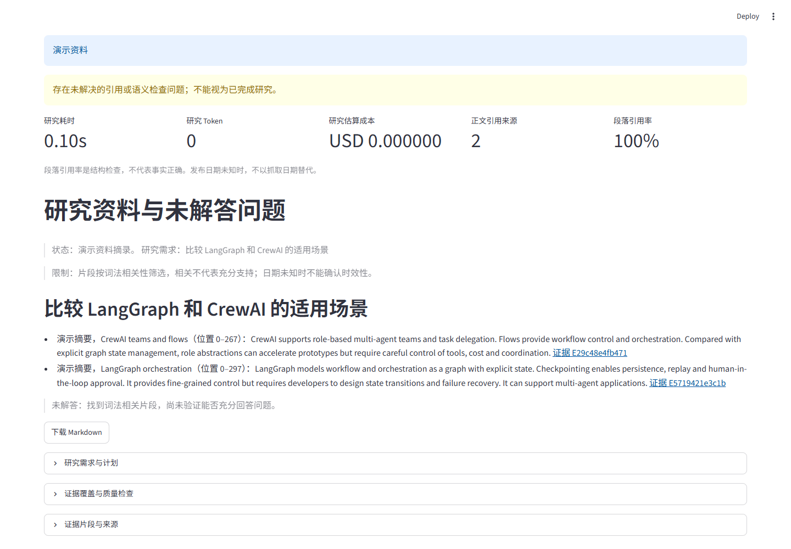
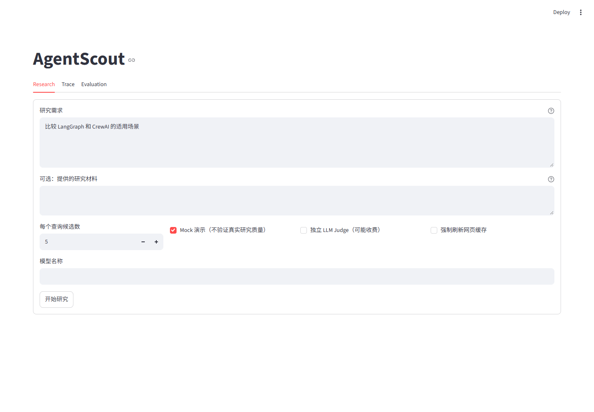
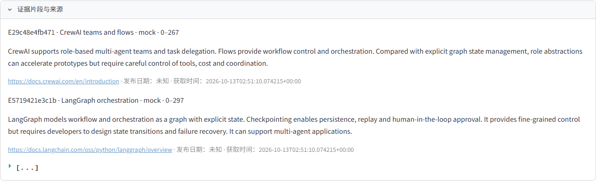
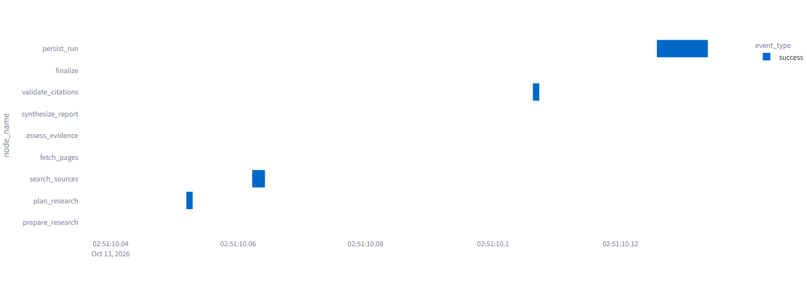
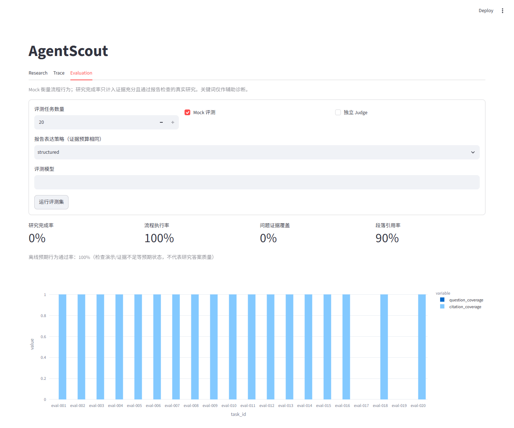

# AgentScout

基于 **LangGraph** 的单用户 AI 研究助手：将研究需求拆解为问题，通过“检索 → 抓取 → 证据筛选 → 校验”生成带来源的报告，并明确展示未解答问题与证据限制。配套 Streamlit 看板、SQLite 执行记录和自动化测试。

适合技术方案调研、资料对比和给定文本分析。支持无需密钥的 Mock 演示，也支持连接模型 API 与 Tavily 进行真实研究。当前为同步、单用户 MVP。

*上图为 Mock 资料摘录，用于展示操作和结果结构；不代表真实模型的研究质量。真实联网案例及其未达标原因见下文。*

[快速开始](#快速开始) · [操作与截图](#操作与截图) · [真实研究案例](#真实研究案例) · [工作流与设计](#工作流与设计) · [测试与验证](#测试与验证) · [常见问题](#常见问题)

## 核心能力

| 能力 | 当前实现 |
|---|---|
| 研究规划与有限补查 | 保留原始需求及约束，按必要问题规划查询；证据有缺口且预算允许时补查 |
| 长网页证据筛选 | 对已获取的清洗正文分块，按问题相关性及来源多样性选材，不固定截取网页开头 |
| 可追溯引用与质量检查 | 记录证据 ID、来源、原文位置和类型；检查正文引用、问题覆盖与模型语义评价 |
| 异常降级与资源控制 | 搜索或模型失败时保留可用资料和未解答问题；限制轮数、调用、下载、Token 与时间预算 |
| 运行追踪与离线评测 | 查看节点时间线、耗时、Token 和错误；区分流程执行率、研究完成率和 Mock 预期行为 |

## 快速开始

### 1. 安装

需要 **Python 3.11+**。在仓库根目录执行，并保留 `data/mock_sources.json` 与 `evals/dataset.json`。

Windows PowerShell：

~~~powershell
py -3.11 -m venv .venv
.\.venv\Scripts\python.exe -m pip install -r requirements.txt
~~~

Linux / macOS：

~~~bash
python3 -m venv .venv
.venv/bin/python -m pip install -r requirements.txt
~~~

下文使用 Windows 路径，Linux / macOS 将 `.\.venv\Scripts\python.exe` 替换为 `.venv/bin/python`。

### 2. 无需密钥，先体验 Mock 演示

~~~powershell
.\.venv\Scripts\python.exe -m streamlit run scripts/demo_app.py --server.address 127.0.0.1 --server.port 8502 --browser.gatherUsageStats false
~~~

打开终端显示的本地地址，按以下步骤体验：

1. 在 **Research** 输入“比较 LangGraph 和 CrewAI 的适用场景”。
2. 保持 **Mock 演示** 勾选、**独立 LLM Judge** 关闭，点击“开始研究”。
3. 查看“演示资料”状态、资料摘录和证据，下载 Markdown。
4. 在 **Trace** 查看节点时间线；在 **Evaluation** 保持 Mock 评测，运行 20 条离线任务。

演示入口运行同一个 `app.py`，使用空密钥配置和独立的 `data/readme-demo.db`，不读取本机 `.env`，也不写入正常使用的数据库。Mock 使用仓库内的教学资料，不验证真实网页或模型回答。

也可以直接运行命令行演示：

~~~powershell
.\.venv\Scripts\python.exe -m agent "比较 LangGraph 和 CrewAI 的适用场景"
~~~

### 3. 配置真实研究

首次使用时复制配置模板；已有 `.env` 时保留原配置：

~~~powershell
if (-not (Test-Path .env)) { Copy-Item .env.example .env }
~~~

在 `.env` 中填写模型服务与搜索服务配置。以下为本项目 2026-10-13 实测使用的 DeepSeek 接入示例，密钥均为占位符：

~~~dotenv
LLM_PROVIDER=openai_compatible
LLM_BASE_URL=https://api.deepseek.com
LLM_API_KEY=YOUR_MODEL_API_KEY
LLM_MODEL=deepseek-flash
LLM_THINKING_MODE=disabled
SEARCH_PROVIDER=tavily
TAVILY_API_KEY=YOUR_TAVILY_API_KEY
~~~

| 配置项 | 用途 |
|---|---|
| `LLM_BASE_URL` | 模型供应商的 API 基础地址，不是聊天网页或 Tavily MCP 地址 |
| `LLM_API_KEY` / `LLM_MODEL` | 模型服务密钥与供应商实际支持的模型标识 |
| `LLM_THINKING_MODE` | `default` 不发送扩展字段；`enabled` / `disabled` 显式设置供应商支持的思考模式，其他供应商先保留 `default` |
| `SEARCH_PROVIDER` | 决定界面默认是否启用 Mock；CLI 仍以 `--real` 明确选择真实模式 |
| `TAVILY_API_KEY` | Tavily 搜索服务的密钥；项目调用 REST 搜索接口，只填写密钥本身 |

密钥只读取根目录 `.env`，不回退到同名系统环境变量；`.env` 已被 Git 忽略。模型名可在界面或 CLI 覆盖。

启动正常入口：

~~~powershell
.\.venv\Scripts\python.exe -m streamlit run app.py --server.address 127.0.0.1 --browser.gatherUsageStats false
~~~

在 Research 取消勾选 Mock，确认模型名称后开始研究。真实模型、搜索及可选独立 Judge 可能收费；本地估算为零不能解释为免费。

~~~powershell
# 真实搜索与模型调用
.\.venv\Scripts\python.exe -m agent "根据 SQLite 官方文档解释 WAL 的并发写入限制，引用原文" --real --output data/report.md
# 只分析 UTF-8 文本材料；不联网指不使用外部检索，真实模式仍会调用模型 API
.\.venv\Scripts\python.exe -m agent "仅根据提供的材料总结，不要联网" --material data/material.txt --real
# 绕过页面缓存，重新获取资料
.\.venv\Scripts\python.exe -m agent "研究当前的相关证据" --real --refresh
~~~

`data/material.txt` 需自行准备。CLI 退出码：`0` 为研究完成或明确标注的演示，`1` 为执行失败，`2` 为部分结果、证据不足或需要复核。产生了报告时，即使未完成研究也会保存。

## 操作与截图

以下五个视图均来自新版界面。Research / Trace 展示一次本地 Mock 任务，Evaluation 展示 20 条 Mock 任务；截图中的零 Token、低耗时和零估算费用不代表真实服务表现。

### 输入研究需求

说明研究目标、时间范围、排除项和输出要求；已有文本放入“提供的研究材料”。界面直接接收研究需求，无需选择任务类别。仅使用材料时，在需求中明确写“仅根据提供的材料，不要联网”。

### 阅读报告并检查状态

首页预览展示本步骤：先查看结果状态及警告，再阅读报告、打开引用、下载 Markdown。`demo` 是演示资料，`needs_review` 表示需要复核；流程结束不等于研究达标。[查看完整 Mock 示例摘录](docs/sample-report.md)。

### 追溯证据

展开“证据片段与来源”，核对证据 ID、类型、清洗正文中的位置与来源地址。`mock` 为教学摘要，`snippet` 为搜索摘要，两者都不能当作已核实的完整网页正文。

### 查看执行轨迹

在 Trace 选择运行记录，查看节点耗时、事件和运行详情。图中的 `persist_run` 是图执行后的持久化记录，8 个 LangGraph 工作流节点之外还会记录该步骤。节点事件 `success` 表示该步骤执行结束，不表示研究质量达标。

### 运行离线评测

在 Evaluation 勾选 Mock，选择任务数量与表达策略后运行。新版把“研究完成率”和“流程执行率”分开；Mock 研究完成率为 0 是预期口径，预期行为通过率用来检查演示和证据不足等状态是否正确。

截图说明及复拍方法见 [截图目录](docs/screenshots/README.md)。旧 `docs/research.png`、`report.png`、`trace.png`、`evaluation.png`、`mobile.png` 和 `demo.webm` 是历史材料，不作为新版功能或指标的证据。

## 真实研究案例

**任务（2026-10-13）**：根据 SQLite 官方文档，解释 WAL 是否允许多个写入者同时写入，以及开启 WAL 后 SQLITE_BUSY 是否仍可能发生。两问分别作答，引用原文。

使用 DeepSeek `deepseek-flash`、Tavily REST 搜索和真实网页，针对同一任务进行了三次迭代验证。以第二次为例：

| 阶段 | 实际发生的行为 |
|---|---|
| 输入与规划 | 保留“两问分别作答、官方文档、引用原文”的要求并生成查询；本次规划将两问放入同一个评估项，未拆成两个独立项 |
| 搜索与抓取 | 进行了 4 次搜索调用，取得官方 WAL 页面及论坛页面；官方清洗正文为 31,487 字符 |
| 证据选择 | 入选官方正文片段包含位置 25,433–25,495 的内容，能够使用旧版 8,000 字符限制之后的信息 |
| 回答 | 报告给出“同一时刻只有一个写入者”和“仍可能发生 SQLITE_BUSY”的核心结论 |
| 检查与保存 | 模型语义审查判通过，但结构检查仅 5/16 正文单位带有本段合法引用，最终保存为 `needs_review`，`success=false` |

已下载的官方正文可以核对上述核心结论，但报告中的部分官方页面引用实际使用的是搜索摘要证据，另有已披露的论坛二手引文。有限的证据预算仍可能遗漏相关片段，模型审查也可能误判；不能把这次结果描述为完整、无遗漏的官方文档研究。

[查看本次原始报告](data/live-validation-2026-10-13/sqlite-wal-nonthinking-report.md) · [查看检查结果](data/live-validation-2026-10-13/sqlite-wal-nonthinking-summary.json) · [查看三次运行记录](data/live-validation-2026-10-13/README.md)

## 工作流与设计

~~~mermaid
flowchart TD
    IN[研究需求与可选材料] --> A[prepare_research 保留需求与约束]
    A --> B[plan_research 规划问题与查询]
    B --> C[search_sources 按问题轮转搜索]
    C --> D[fetch_pages 获取正文并记录限制]
    D --> E[assess_evidence 分块选材与充分性评估]
    E -->|有缺口且有预算| C
    E -->|证据足够或停止补查| F[synthesize_report 回答或资料摘录]
    F --> G[validate_citations 引用及语义检查]
    G --> H[finalize 确定结果状态]
    H --> OUT[保存报告与执行轨迹]
~~~

LangGraph 图包含 **8 个节点**。补查受轮数、调用和资源预算限制；报告最多修复一次。节点快照与最终轨迹写入 SQLite，可选独立 Judge 单独保存评审，不修改原研究的状态、费用或轨迹。

| 设计问题 | 当前处理 | 边界 |
|---|---|---|
| 研究需求被任务分类改写 | 保留原始需求，用户材料与指令分开；取消研究主题 / 岗位描述分流 | 自然语言约束识别仍依赖有限规则与模型 |
| 长页面后半段被固定截断 | 扫描已获取正文的段落、表格和长段落尾部，按相关性选材 | 下载及上下文均有预算，词法匹配可能漏掉同义表达 |
| 抓取失败后摘要被当作正文 | 分别记录正文、搜索摘要、不完整下载与失败原因 | 摘要只能作为有限证据，不能独自支持充分性判定 |
| 有链接就算研究完成 | 核对证据 ID 与 URL，检查正文单位引用、问题覆盖和语义支持 | 结构合法不代表事实成立；同一模型审查并非独立事实核验 |
| API 异常或无限补查 | 有限重试、预算停止；降级输出资料摘录与未解答问题 | 降级保持可用信息，不保证完成原任务 |

详细约束与回归场景见 [研究逻辑说明](docs/research-logic.md)。

### 技术栈

| 技术 | 在项目中的职责 |
|---|---|
| Python 3.11+ / Pydantic | 业务逻辑、状态结构与配置校验 |
| LangGraph | 节点编排、状态传递和有限补查分支 |
| Streamlit / Plotly | Research、Trace、Evaluation 页面和图表 |
| SQLite | 节点快照、研究结果索引及独立评审持久化 |
| OpenAI 兼容 API | 云端规划、证据评估、报告生成和语义检查；本项目实测接入 DeepSeek |
| Tavily / HTTPX / Beautiful Soup | 外部搜索、网页请求及 HTML 内容提取 |
| pytest | 单元、异常分支和界面集成测试 |

## 配置与预算

预算集中在 `config.py`；所有字段支持大写同名 `.env` 配置，由 Pydantic 校验范围。完整模板见 [.env.example](.env.example)。

| 配置 | 默认值 | 含义 |
|---|---:|---|
| MAX_QUESTIONS | 8 | 必要子问题上限，允许只有一个问题 |
| MAX_SEARCH_CALLS / MAX_CANDIDATES | 12 / 30 | 搜索尝试总数 / 候选池上限 |
| MAX_FETCH_PAGES / MAX_ROUNDS | 8 / 2 | 获取页面数 / 检索评估轮数 |
| MAX_LLM_CALLS | 10 | 包括重试、审查、修复的研究模型调用上限 |
| MAX_TOTAL_TOKENS | 100000 | 调用前估算的整次研究 Token 上限 |
| MAX_COST_USD | 0 | 模型估算费用上限；0 关闭该上限 |
| RESEARCH_TIMEOUT_SECONDS | 180 | 协作式研究时间预算，超时停止新工作 |
| LLM_TIMEOUT_SECONDS | 30 | 单次模型网络操作超时 |
| MAX_DOWNLOAD_BYTES | 2000000 | 单页解码后响应字节预算，达到上限会明确标注不完整 |
| CACHE_TTL_SECONDS | 600 | 页面缓存有效期；0 禁用读取和写入 |
| CONTEXT_TOKEN_BUDGET / EVIDENCE_TOKEN_BUDGET | 16000 / 6500 | 单次上下文 / 证据选材 Token 预算 |
| PLAN_MAX_TOKENS / REPORT_MAX_TOKENS / REVIEW_MAX_TOKENS | 1800 / 4000 / 2400 | 各阶段输出 Token 上限 |

`PRICE_PER_MILLION_TOKENS` 为供应商输入/输出混合单价，需自行填写；0 表示未配置价格，不代表免费。设置金额上限却未配置价格时拒绝模型调用。预算是近似估算，不是供应商精确账单；搜索供应商费用另计。无 usage 的失败请求会保留预算占用并标记费用未知，不把未知收费当零。独立 Judge 使用相同配置限制自身的一次评审，费用另列，不占用已结束的研究记录。

HTTP 超时按网络操作计算，总时间预算无法强制打断所有 DNS/底层阻塞。原始需求过长时明确降级，不静默删掉后半段约束。

## 证据与完成状态

- 扫描已获取的清洗段落、表格行与长段落尾部，按问题相关性及来源多样性选材，不再固定保留前 8,000 或前 1,000 字符。
- 下载不完整、只获取到摘要、未入选片段数量均可查；不会宣称已完整阅读页面。HTTP 200 的验证/拦截页不能直接作为成功正文。
- 每条证据保存来源、证据 ID、类型、原文位置、获取时间和可获得的发布日期。搜索摘要、网页正文、用户材料、Mock 教学摘要分别标记。
- 每个问题评为 `supported`、`partial`、`missing` 或 `conflicting`。针对缺口补查；发布日期或抓取日期本身不能证明内容适用于指定时间。
- 正文事实单位引用具体证据 ID 和 URL。先检查其是否对应选中片段，再检查回答是否遵守需求、有证据支持；最多修复一次，修复失败保留原报告。

| 状态 | 意义 |
|---|---|
| `completed` | 必要问题证据充分、引用通过且模型语义检查通过 |
| `partial` | 有资料，但问题覆盖、时效确认或模型回答尚未完成 |
| `needs_review` | 已有回答，引用或语义检查仍有问题 |
| `insufficient_evidence` | 没有可用的入选证据 |
| `demo` | 使用 Mock 教学资料，不能算真实研究完成 |
| `failed` | 关键节点或保存失败 |

`execution_status=finished` 仅表示流程运行完毕；`success` 只在 `completed` 时为真。`completed` 也不是对客观事实绝对正确的保证：充分性和语义检查仍由模型判断，关键结论应人工核对。

缺少模型配置、调用失败、响应被截断或预算不足时，可以保留真实检索资料并输出明确标注的摘录与未解答问题，不伪装成完成答案。没有匹配资料时不会填充无关 Mock 来源。

## 测试与验证

### 已有结果

验证记录截至 **2026-10-13**：

| 验证 | 规模及结果 | 能说明什么 |
|---|---|---|
| pytest 自动化检查 | 85 项通过 | 已定义行为和异常分支的回归检查通过，不是事实准确率 |
| 20 任务离线评测 | 已保存的 baseline / structured 各 20 条：18 条 `demo`、2 条 `insufficient_evidence`；流程执行率和预期行为通过率均为 100%，研究完成率为 0% | 验证 Mock 行为与状态口径，两种策略不能据此比较真实模型质量 |
| 真实联网迭代验证 | 同一 SQLite WAL 任务运行 3 次，2 次 `partial`、1 次 `needs_review`，均运行结束，均未达 `completed` | 验证了真实服务接入，并暴露来源选择及段落引用问题；不是代表性评测集 |

| 真实尝试 | 研究状态 | 耗时 | API 返回 Token |
|---|---|---:|---:|
| 默认思考模式 | `partial` | 63.235 秒 | 15,974 |
| 关闭思考模式 | `needs_review` | 32.197 秒 | 24,401 |
| 关闭思考模式并明确逐段引用要求 | `partial` | 35.889 秒 | 13,603 |

三次已知 usage 合计 **53,978 Token**，不含失败请求的未知消耗，实际账单未核对。三次检索、规划与配置不同，不是受控实验，不能据此计算一般准确率或宣称优化幅度。最新追加的原文链接转义提示尚未再次联网验证。

本轮修复了转义 Markdown 链接误判，增加思考模式配置，并隔离 UI 测试的真实凭据。仍待改善来源优先级、同页不同 URL 去重、逐段引用稳定性及评估粒度。[完整真实验证记录](data/live-validation-2026-10-13/README.md) · [离线结果口径](evals/results/README.md)。

### 运行检查

~~~powershell
.\.venv\Scripts\python.exe -m pytest -q
.\.venv\Scripts\python.exe -m evals.runner --variant baseline --limit 20 --output evals/results/mock-v2-baseline.json
.\.venv\Scripts\python.exe -m evals.runner --variant structured --limit 20 --output evals/results/mock-v2-structured.json
~~~

真实评测会调用模型和搜索服务，配置好供应商及预算后单独运行：

~~~powershell
.\.venv\Scripts\python.exe -m evals.runner --real --limit 10 --model YOUR_MODEL --output evals/results/live-v2.json
~~~

数据集覆盖通常研究、领域外查询、限定材料、缺失材料与时间范围。baseline 和 structured 使用相同取证预算，只改变模型回答的表达要求；Mock 使用同一本地摘录器，输出相同属于预期行为。

### 如何解读指标

- **流程执行率**：执行到正常结束的比例，可包含证据不足。
- **研究完成率**：只接受 `completed`，并重新检查报告、逐问题证据、引用与语义检查结果。
- **预期行为通过率**：离线任务是否得到预设的 `demo` 或 `insufficient_evidence` 等状态。
- **段落引用率**：需要证据的正文单位中，带合法引用的比例；来源列表不能代替正文引用，也不能证明论断成立。
- **来源利用率**：正文合法引用的来源占入选证据来源的比例，与段落引用率分开。
- **关键词召回**：剔除需求回显、标题和来源列表后进行中英文别名匹配，仅辅助诊断，不决定完成。
- **费用**：研究与独立 Judge 分列；有 usage 时记录供应商返回值，否则标记估算或未知。

只有 `schema_version=2` 结果进入当前 Evaluation 对比；旧版 `mock-baseline.json` 和 `mock-structured.json` 保留为历史材料，旧“100% 完成率”不能与新版口径比较。

## 常见问题

**为什么流程结束了，仍显示“部分结果”或“需要复核”？**

`execution_status=finished` 只说明程序执行结束。缺少证据、时效不明确、正文漏引或语义检查未通过，都可能阻止研究被判定为完成。先在“证据覆盖与质量检查”查看缺口，再决定补充材料、调整问题或人工复核。

**为什么 Mock 的研究完成率是 0%，预期行为通过率却是 100%？**

Mock 没有验证真实页面与模型回答，所以不记为研究完成；如果各任务都正确返回了预设的演示或证据不足状态，其预期行为检查仍可全部通过。两项指标衡量不同内容。

**为什么真实运行的估算费用也可能显示 0？**

默认混合单价为 0，表示未配置价格。需要自行填写 `PRICE_PER_MILLION_TOKENS`，并以供应商账单为准；搜索费用另计，失败请求的未知 usage 也不能按免费处理。

**网页打不开或模型调用失败，会发生什么？**

保留搜索摘要、来源状态和错误原因；在预算内重试或补查，必要时输出资料摘录与未解答问题。没有可用证据时返回 `insufficient_evidence`，关键执行或保存错误才是 `failed`。

**“不要联网”是否表示数据完全不离开本机？**

该指令限制外部搜索和网页抓取。真实模式下仍会将用于规划、回答和审查的文本发送至配置的模型 API；仅本地演示应使用 Mock 并关闭独立 Judge。

**Tavily 的 MCP 链接能直接填入模型接口地址吗？**

不能。模型接口地址填写模型供应商的 `LLM_BASE_URL`。本项目通过 Tavily REST 搜索，只需把搜索密钥填入 `TAVILY_API_KEY`，无需配置 MCP 链接。

**运行记录保存在哪里？可以自动续跑吗？**

正常入口默认写入 `data/agent_scout.db`；可通过进程环境变量 `AGENTSCOUT_DB` 指定其他 SQLite 路径。每个任务独立生成 run ID，节点快照用于查看和排查，当前不自动恢复中断任务。演示入口使用单独的 `data/readme-demo.db`。

## 项目结构

~~~text
AgentScout/
├── app.py                 # Streamlit 三个功能页
├── config.py              # 配置、资源预算与错误脱敏
├── agent/
│   ├── graph.py           # 8 节点流程与条件补查
│   ├── nodes.py           # 节点实现
│   ├── evidence.py        # 分块、选材与证据处理
│   ├── citations.py       # 引用结构检查
│   └── llm.py             # 模型调用与思考模式配置
├── models/                # 需求、证据、评估等数据结构
├── tools/                 # 搜索、下载与清洗
├── storage/               # SQLite 研究记录与评审
├── observability/         # 节点轨迹
├── evals/                 # 20 条任务、指标、Judge 与结果
├── tests/                 # 自动化测试
├── scripts/               # 演示入口、截图和真实服务验证
├── docs/                  # 研究逻辑、示例与新版截图
└── data/                  # Mock 语料、运行记录与本地数据库
~~~

## 存储与安全

每次研究生成新 run ID，不缓存并重用整个研究结果。页面缓存最多 128 项、按 TTL 失效；命中保留原获取时间，显式刷新和时间范围任务绕过缓存。SQLite 保存节点快照和最终状态，Judge 独立存储；旧记录可读且标记 `legacy`。

外部网页与报告按不可信数据处理，不执行其中的命令。抓取拒绝私有地址并检查重定向，但不是防 DNS rebinding 的生产级沙箱。密钥脱敏；输入、用户材料、来源和报告在本机数据库中明文保存。界面默认绑定 `127.0.0.1`，无登录和多租户权限。

## 已知限制与后续方向

- **取证范围**：目前支持 HTML、XHTML 与纯文本；PDF、图片文字和需要动态渲染的页面尚无专门解析。
- **证据召回**：词法相关性和有限上下文可能遗漏证据，后续可评估语义检索；全文扫描不等于全文进入模型上下文。
- **来源选择**：真实运行暴露官方文档优先级和重复 URL 问题，官方域名中的论坛不能自动视为官方文档。
- **评估与引用**：多问合并规划、正文漏引及模型误判仍需改善；结构检查和同模型语义审查不能保证事实绝对正确。
- **运行机制**：当前同步、单用户，不支持自动断点续跑；时间预算是协作式停止，不是对所有底层阻塞的硬中断。
- **质量验证**：已有小规模真实冒烟验证，尚缺覆盖多个领域的真实供应商评测、人工标注和受控比较。
